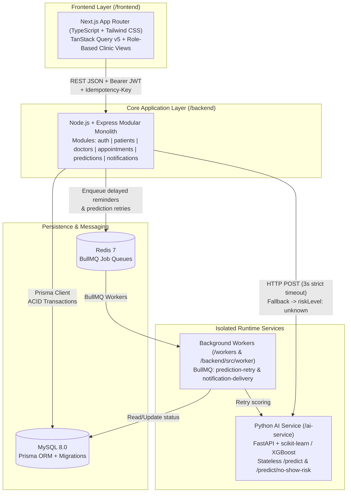

# FastRev System Architecture

FastRev is a clinic and patient management platform with an AI-powered appointment no-show prediction engine. It combines a **Modular Monolith** core API for strict transactional consistency with an isolated **Python FastAPI ML microservice** and **Redis + BullMQ background workers** for fault tolerance.

---

## 1. High-Level Topology



---

## 2. Repository Structure

```text
E:\FastRev
├── frontend/          # Next.js (App Router, TypeScript, Tailwind CSS, TanStack Query)
├── backend/           # Node.js + Express + TypeScript modular monolith + Prisma ORM
│   ├── prisma/        # Canonical MySQL schema.prisma & sequential SQL migrations
│   ├── src/
│   │   ├── common/    # Zod env validation, singleton Prisma client, error handler, logger
│   │   ├── modules/   # Domain modules (auth, patients, doctors, appointments, predictions, notifications)
│   │   └── worker/    # Shared BullMQ queue producers & co-located worker runtime
│   └── tests/         # Vitest unit & integration suites
├── ai-service/        # Stateless Python FastAPI microservice (scikit-learn/XGBoost + rule fallback)
├── workers/           # Standalone BullMQ worker workspace package (Redis consumer runtime)
├── docs/              # Architecture specs, ER diagrams, model evaluation, and ADRs
└── docker-compose.yml # Full local/container orchestration (MySQL, Redis, API, Worker, AI, Frontend)
```

---

## 3. Core Architectural Invariants

### 3.1 Three-Layer Doctor Double-Booking Prevention
Clinic scheduling requires strict relational guarantees so a doctor can never be booked for overlapping visits:
1. **Row-Level Serialization**: Booking opens a MySQL transaction and executes `SELECT id FROM doctors WHERE id = ? FOR UPDATE`, serializing concurrent booking requests for the same doctor.
2. **Duration Overlap Check**: Inside the lock, a range query checks `scheduled_at < newEnd AND DATE_ADD(scheduled_at, INTERVAL duration_minutes MINUTE) > newStart` across all non-cancelled appointments.
3. **Database Unique Constraint (`active_slot_key`)**: Each active appointment stores `${doctorId}:${isoTimestamp}` in a `@unique` column. When an appointment is cancelled, `activeSlotKey` is set to `NULL`, freeing the slot for rebooking while keeping a hard DB-level backstop against duplicate active start times.

### 3.2 Fault-Tolerant AI Prediction (3-Second Timeout Fallback)
- The Node backend calls the Python AI service over HTTP with a **strict 3,000 ms timeout** (`AI_PREDICT_TIMEOUT_MS=3000`).
- **AI Service Offline / Timeout**: Appointment creation **still succeeds**. The backend persists a `Prediction` record with `riskLevel = 'unknown'` and `noShowProbability = null` (or preserves an existing valid score during re-scoring) and enqueues a background job on `prediction-retry`.
- **Cold-Start Patients**: Patients with zero completed or no-show history (`completedAppointmentCount + priorNoShowCount === 0`) are deterministically labeled `new_patient` without fabricating an ML probability.
- **Explainable Predictions**: Predictions store `noShowProbability`, `riskLevel`, `modelVersion`, and structured `reasonCodes` (JSON array of contributing risk factors such as prior no-show rate or long booking lead time).

### 3.3 Asynchronous Reminders & Retry Workers
- SMS/email reminders are never sent synchronously on the booking request path.
- High-risk appointments schedule **48h** and **4h** pre-visit reminders; standard appointments schedule a **24h** reminder (plus a **48h** reminder for new patients booked 14+ days out).
- Cancelling or re-scoring an appointment reconciles pending `Notification` rows and cancels superseded BullMQ delayed jobs via deterministic `dedupeKey`s.

---

## 4. Service Ports & Environment Boundaries

| Service | Default Port | Responsibility | Direct DB Access |
| :--- | :--- | :--- | :--- |
| `frontend` (Next.js) | `3000` | Role-based clinic dashboard, scheduling UI, risk triage | No (calls `backend` REST API) |
| `backend` (Express) | `4000` | Auth, CRUD, double-booking transactions, AI orchestration | Yes (`mysql` via Prisma) |
| `ai-service` (FastAPI) | `8000` | Stateless no-show probability & reason-code inference | No (stateless HTTP) |
| `workers` (BullMQ) | N/A | Async reminder delivery & AI prediction retries | Yes (status updates) |
| `mysql` | `3306` | Primary relational source of truth | — |
| `redis` | `6379` | BullMQ delayed/retry job queues | — |
