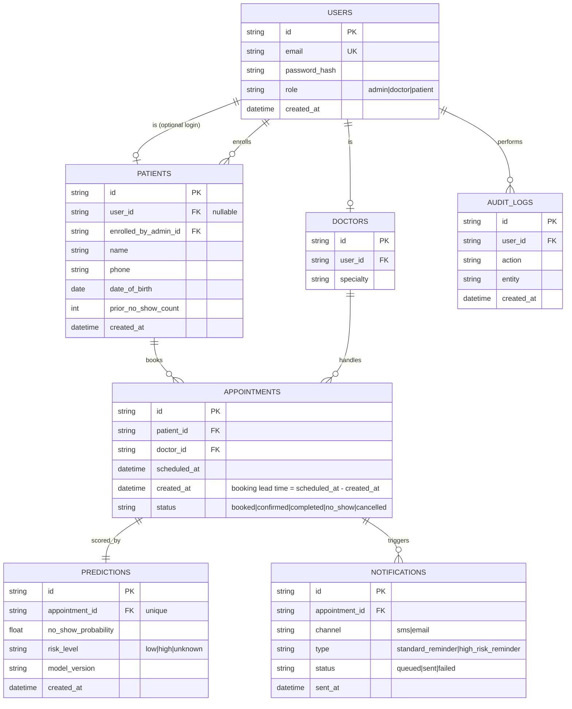

    # FastRev — Full Build Specification & Coding Agent Instructions

> **Purpose of this document:** This is the complete build spec for FastRev — a clinic/patient management platform with an AI-powered no-show prediction engine. It is written to be handed directly to an AI coding agent (Kilo Code or similar) to build the project end to end, incrementally, with guardrails against the most common causes of production crashes. Keep this file in the repo at `/docs/BUILD_SPEC.md` and update it as the system evolves — it is the single source of truth for architecture.

----------

## 1. What FastRev Is (business context, not just tech)

FastRev is a clinic/patient management system. Its core commercial value proposition, stated in plain English for a non-technical client:

> "This system predicts which patients are likely to miss their appointment, so the clinic can send them an extra reminder or fill that slot with another patient — before the revenue is lost."

Industry data grounding this problem (do not remove — this is the business justification for the whole AI layer):
- Average healthcare no-show rate: ~27% (ranges 5–30% by specialty/setting)
- Average daily revenue loss from no-shows: ~14%
- Independent practices lose $150,000–$1,000,000/year to no-shows
- AI-driven prediction + scheduling tools have been shown to cut no-shows by 42–50%+ in real deployments

Every feature in this spec must trace back to reducing no-show-driven revenue loss, or to the basic clinic operations (patient records, scheduling, roles) needed to support that. No feature should be added "because it looks impressive" — if it doesn't serve the business problem above or basic operational necessity, do not build it.

---

## 2. ADR-001: Modular Monolith + Separated AI Service (not full microservices)

**Context:** The system needs loose coupling and fault tolerance (a failure in one part should not take down the whole system), and needs to scale the AI prediction workload independently of the core CRUD workload. Full microservices (separate Auth Service, Patient Service, Appointment Service, Notification Service, each with its own database and deployment) was considered.

**Decision:** Build the core application (auth, patients, doctors, appointments, admin) as a **single, well-modularized Node.js backend** (a "modular monolith" — internally separated into clean layers/modules, but deployed as one service with one database). Separate out **only** the ML/AI workload into its own service, because it is a genuinely different runtime (Python, not Node) and a genuinely different scaling profile (CPU-bound inference vs. I/O-bound CRUD). The **notification/reminder worker** is also separated as a background process (not a full network service — it shares the database but runs as an independent process/container so it can be scaled or restarted without touching the API).

**Alternatives considered:**
- Full microservices per domain (Auth, Patient, Appointment, Notification, AI as 5 separate services with separate DBs) — rejected for this stage: adds significant operational complexity (service discovery, distributed transactions, network failure handling between every domain) without a real scale requirement to justify it. This would be "microservices for the CV," which this project explicitly avoids.
- Single monolith including the AI/ML code in Node — rejected: Python has the ML ecosystem (scikit-learn, pandas); forcing ML into Node would mean reimplementing or badly wrapping that ecosystem.

**Reasoning:** Two service boundaries (Node API+DB, Python AI service) already deliver the loose coupling and fault tolerance goals that matter in practice:
- If the AI service is down, the core app (booking, patient records, admin) keeps working. Appointments are still created; they just don't get a risk score until the AI service is back (see §6 fault-tolerance rules).
- If the notification worker crashes, booking and dashboards still work; reminders just queue up and get sent once the worker restarts (Redis-backed queue, not fire-and-forget).
- The AI service can be scaled to more instances under prediction load without touching the main API.

**Consequences:** Slightly more deployment complexity than a pure monolith (3 deployable units: API, AI service, worker — plus MySQL and Redis). In exchange, real fault isolation and a defensible "why we chose this" story, without the overhead of full microservices sprawl.

---

## 3. ADR-002: MySQL + Prisma (not MongoDB)

**Context:** Core entities (Patients, Doctors, Appointments, Predictions, Notifications) have strict relational integrity requirements: an appointment must reference exactly one valid patient and one valid doctor; a doctor must not be double-booked at the same time; dashboard reporting requires joins and aggregations across these entities.

**Decision:** MySQL as the primary datastore, accessed through Prisma ORM (TypeScript-native, migration-managed, type-safe queries).

**Alternatives considered:** MongoDB — rejected because document databases don't enforce relational integrity or unique-constraint-across-fields (e.g., "no doctor double-booked in the same time slot") as cleanly as a relational DB with proper constraints; this would push validation logic into the application layer where it's easier to get wrong (as seen in the legacy Aid-Connect backend, which had no such protections at all).

**Consequences:** Requires proper schema migrations (Prisma handles this) instead of MongoDB's schema flexibility — an acceptable and appropriate trade-off given the relational nature of the domain.

---

## 4. System Architecture Diagram

```
                    ┌─────────────────────────┐
                    │   React Frontend (SPA)  │
                    │  Vite + TS + Redux/RTKQ │
                    └────────────┬─────────────┘
                                 │ HTTPS / REST
                    ┌────────────▼─────────────┐
                    │   Node.js API (Express)  │
                    │  Modular monolith:        │
                    │  auth / patients / doctors│
                    │  / appointments / admin   │
                    └──────┬──────────────┬─────┘
                            │              │
                 ┌──────────▼───┐   ┌──────▼──────────┐
                 │  MySQL (via  │   │  Redis (queue +  │
                 │   Prisma)    │   │  cache)          │
                 └──────────────┘   └──────┬───────────┘
                            │              │
                 ┌──────────▼───┐   ┌──────▼───────────┐
                 │ P ython AI     │   │ Notification      │
                 │ Service       │   │ Worker (BullMQ)   │
                 │ (FastAPI,     │   │ sends SMS/email   │
                 │ no-show model)│   │ reminders          │
                 └───────────────┘   └────────────────────┘
```

Communication rule: the Node API calls the AI service over HTTP with a **strict timeout (3s) and a fallback** (see §6). The AI service never talks to MySQL directly — it only receives feature payloads from the Node API and returns a prediction. This keeps the AI service stateless and independently deployable.

---

## 5. Folder Structure

```
fastrev/
├── docs/
│   ├── BUILD_SPEC.md              (this file)
│   ├── adr/
│   │   ├── ADR-001-modular-monolith.md
│   │   ├── ADR-002-mysql-prisma.md
│   │   └── ADR-00X-....md         (add one per major decision, never skip this)
│   ├── ARCHITECTURE.md            (living diagram + explanation, update every milestone)
│   └── er-diagram.md              (mermaid ER diagram, source of truth for schema)
│
├── frontend/
│   ├── src/
│   │   ├── app/                   (store.ts, hooks.ts)
│   │   ├── features/
│   │   │   ├── auth/
│   │   │   ├── patients/
│   │   │   ├── appointments/
│   │   │   ├── predictions/
│   │   │   └── admin-dashboard/
│   │   ├── components/            (shared, dumb/presentational only)
│   │   ├── api/                   (RTK Query API slices, one per domain)
│   │   ├── routes/
│   │   └── lib/
│   ├── .env.example
│   └── package.json
│
├── backend/
│   ├── src/
│   │   ├── modules/
│   │   │   ├── auth/
│   │   │   │   ├── auth.routes.ts
│   │   │   │   ├── auth.controller.ts
│   │   │   │   ├── auth.service.ts
│   │   │   │   └── auth.middleware.ts   (verifyToken, requireRole)
│   │   │   ├── patients/
│   │   │   │   ├── patients.routes.ts
│   │   │   │   ├── patients.controller.ts
│   │   │   │   ├── patients.service.ts
│   │   │   │   └── patients.schema.ts   (Zod validation)
│   │   │   ├── doctors/
│   │   │   ├── appointments/
│   │   │   │   ├── appointments.routes.ts
│   │   │   │   ├── appointments.controller.ts
│   │   │   │   ├── appointments.service.ts   (double-booking check lives here)
│   │   │   │   └── appointments.schema.ts
│   │   │   ├── predictions/
│   │   │   │   ├── predictions.service.ts    (calls AI service, has fallback)
│   │   │   │   └── predictions.routes.ts
│   │   │   └── notifications/
│   │   │       ├── notifications.producer.ts (adds jobs to queue)
│   │   │       └── notifications.routes.ts
│   │   ├── common/
│   │   │   ├── middleware/
│   │   │   │   ├── errorHandler.ts    (centralized, catches everything)
│   │   │   │   ├── requestId.ts
│   │   │   │   └── rateLimiter.ts
│   │   │   ├── utils/
│   │   │   ├── config/               (env validation at startup — fail fast)
│   │   │   └── logger.ts             (pino, structured, includes request id)
│   │   ├── prisma/
│   │   │   ├── schema.prisma
│   │   │   └── migrations/
│   │   ├── app.ts                    (express app assembly, no listen())
│   │   └── server.ts                 (listen() + graceful shutdown)
│   ├── worker/
│   │   └── notification.worker.ts    (separate entrypoint, BullMQ consumer)
│   ├── tests/
│   │   ├── unit/
│   │   └── integration/
│   ├── .env.example
│   └── package.json
│
├── ai-service/
│   ├── app/
│   │   ├── main.py                   (FastAPI app)
│   │   ├── models/
│   │   │   └── no_show_model.pkl     (trained artifact, versioned)
│   │   ├── schemas.py                (pydantic request/response models)
│   │   ├── predict.py
│   │   └── health.py                 (GET /health — required)
│   ├── training/
│   │   ├── generate_synthetic_data.py
│   │   ├── train.py
│   │   └── evaluate.py               (writes metrics to docs/model-evaluation.md)
│   ├── tests/
│   ├── requirements.txt
│   └── Dockerfile
│
├── docker-compose.yml
├── .github/workflows/ci.yml
└── README.md
```

---

## 6. Business Logic Rules (must be implemented exactly as described)

1. **Double-booking prevention:** Before creating an appointment, check for an existing appointment for the same `doctor_id` where the requested time range overlaps. Enforce this at the database level too (unique constraint on `doctor_id` + `scheduled_at`, plus application-level range check for duration-based conflicts) — never rely on application logic alone.

2. **Admin enrolls patients:** Patients do not have to self-register. `POST /api/v1/patients` is callable by Admin/Staff role, creating a patient record with an optional linked `user_id` (patient may or may not get login access).

3. **Prediction flow (with fault tolerance):**
   - On appointment creation, the backend calls `POST {AI_SERVICE_URL}/predict/no-show-risk` with a 3-second timeout.
   - **If the AI service responds:** store `no_show_probability` and `risk_level` in the `predictions` table, linked to the appointment.
   - **If the AI service times out, errors, or is unreachable:** do NOT fail the appointment creation. Log the failure, store a `predictions` row with `risk_level = 'unknown'`, and queue a retry job. The appointment booking API must always succeed independently of AI service health — this is the fault-tolerance guarantee described in ADR-001.

4. **Notification rules:**
   - `risk_level = 'low'`: one reminder, 24 hours before appointment.
   - `risk_level = 'high'`: two reminders — 48 hours and 4 hours before appointment.
   - `risk_level = 'unknown'`: treat as default/low — never let missing AI data suppress the standard reminder.
   - All sends go through the notification worker (queued, not sent synchronously from the API request) so a slow SMS provider never blocks a user-facing API call.
   - Every notification attempt is logged with status (`sent`, `failed`, `retrying`) — retry up to 3 times with exponential backoff, then mark `failed` and surface it on the admin dashboard.

5. **Idempotency:** All state-changing POST/PATCH endpoints that could plausibly be retried by a flaky client (appointment creation, patient enrollment) must accept an optional `Idempotency-Key` header; if a request with the same key was already processed, return the original result instead of creating a duplicate.

6. **Consistent API response shape** (every endpoint, no exceptions):
   ```json
   { "success": true, "data": { }, "message": "..." }
   { "success": false, "message": "...", "error": { "code": "...", "details": "..." } }
   ```

---

## 7. Database Schema (source of truth — Prisma models)

Entities: `users`, `patients`, `doctors`, `appointments`, `predictions`, `notifications`, `audit_logs`.



Required indexes: `appointments(doctor_id, scheduled_at)`, `appointments(patient_id)`, `predictions(appointment_id)` unique, `notifications(appointment_id)`, `users(email)` unique.

---

## 8. Rules to Prevent Production Crashes (non-negotiable, apply to every module)

1. **Fail fast on missing config.** Validate all required environment variables at startup (Zod schema over `process.env`); if any are missing, the process must exit immediately with a clear error — never start in a half-configured state.
2. **Every async route handler wrapped**, errors passed to `next(err)`, caught by one centralized error-handling middleware. No route may throw unhandled.
3. **No raw driver + ORM mixing.** Use Prisma exclusively for all DB access — this exact bug (Mongoose model defined but unused, raw MongoClient used instead, connections leaked) was found in the legacy Aid-Connect backend and must not be repeated.
4. **Every external call (AI service, SMS/email provider) has an explicit timeout and a defined fallback behavior.** Never let an external dependency's failure become your own outage.
5. **TypeScript strict mode, no `any`** in backend and frontend.
6. **Input validation with Zod at the controller boundary**, before any data reaches a service or the database.
7. **`/health` endpoint on every service** (API, AI service) returning DB/dependency connectivity status — required for Docker healthchecks and future monitoring.
8. **Graceful shutdown:** on `SIGTERM`, stop accepting new requests, finish in-flight ones, close DB and Redis connections cleanly before exiting.
9. **Rate limiting** on all public-facing auth routes (login, register) to prevent abuse.
10. **Structured logging with a request ID** on every log line, so a single failing request can be traced end to end across API and worker logs.
11. **Tests required before a feature is considered done:** at minimum one unit test (service logic) and one integration test (API endpoint) per module; the AI service requires a model-evaluation test that fails the build if accuracy/F1 drops below a defined threshold versus the last committed model.
12. **CI must block merges** that fail lint, type-check, or tests — no exceptions, no "fix it later."

---

## 9. Documentation the Agent Must Keep Updated

- `docs/ARCHITECTURE.md` — updated every milestone with what changed and why.
- `docs/adr/ADR-XXX-*.md` — one new file per significant decision, following the Context/Decision/Alternatives/Reasoning/Consequences format used in §2 and §3.
- `docs/er-diagram.md` — kept in sync with `schema.prisma` any time the schema changes.
- `docs/model-evaluation.md` — every time the no-show model is retrained: dataset size, features used, train/test split, precision/recall/F1/confusion matrix, and comparison to the previous model version.
- `README.md` — setup instructions that must actually work on a clean machine (`docker compose up` should be sufficient to run the full stack locally).

---

## 10. Build Order (do not skip ahead)

1. Backend skeleton: Prisma schema + migrations, auth module (register/login/JWT + role middleware), centralized error handling, health endpoint. Write ADR-001 and ADR-002 as real files in `docs/adr/`.
2. Patients + Doctors modules (CRUD, admin-only enrollment for patients).
3. Appointments module, including the double-booking constraint — write a test that proves two overlapping bookings for the same doctor are rejected.
4. AI service skeleton: FastAPI `/predict/no-show-risk` returning a stub value, `/health` endpoint, Dockerfile. Wire the backend's `predictions.service.ts` to call it, including the timeout + fallback behavior — write a test that kills the AI service and proves appointment creation still succeeds.
5. Train the real no-show model on synthetic data (`training/generate_synthetic_data.py` → `train.py` → `evaluate.py`, output to `docs/model-evaluation.md`), swap the stub for the real model.
6. Notification worker: Redis + BullMQ, reminder scheduling rules from §6.4, retry logic.
7. Frontend: auth, admin dashboard (patient list, today's high-risk appointments, simulated revenue-saved metric), patient dashboard (own appointments).
8. Docker Compose wiring all five containers (frontend, backend, worker, ai-service, mysql, redis).
9. CI pipeline (lint, typecheck, test, build) gating merges.
10. Final README, architecture diagram refresh, ADR review pass.

**Do not build features out of this order.** Each step should be a working, tested, committed state before moving to the next.