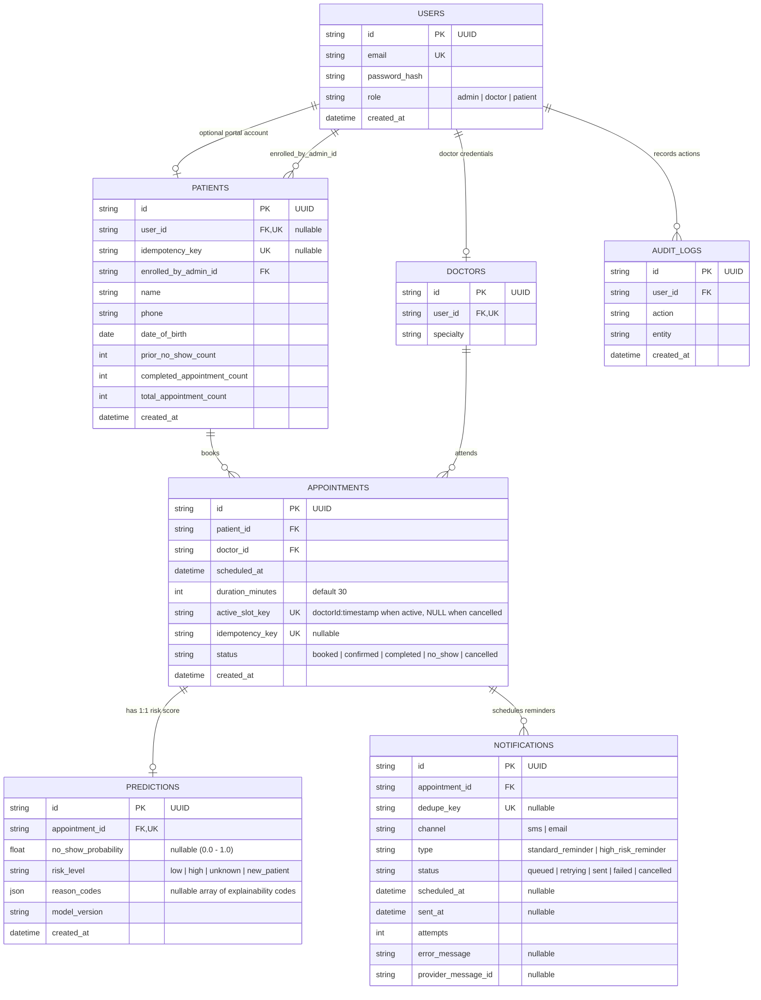

# FastRev — Entity-Relationship Diagram

Canonical relational schema managed by Prisma in [`backend/prisma/schema.prisma`](../backend/prisma/schema.prisma).

## Key Relational Constraints

1. **Doctor Slot Uniqueness & Indexing**:
   - `appointments.active_slot_key` (`@unique`) prevents two non-cancelled appointments from claiming the exact same `(doctor_id, scheduled_at)` slot at the storage engine level while permitting cancelled slots (`active_slot_key = NULL`) to be rebooked.
   - `@@index([doctorId, scheduledAt])` accelerates range overlap queries inside `SELECT ... FOR UPDATE` booking transactions.
2. **One-to-One Appointment Prediction**:
   - `predictions.appointment_id` (`@unique`) guarantees at most one current risk assessment per appointment, updated atomically via `prisma.prediction.upsert`.
3. **Idempotent Mutations & Deduplicated Notifications**:
   - `patients.idempotency_key` (`@unique`) and `appointments.idempotency_key` (`@unique`) prevent duplicate records on network retries.
   - `notifications.dedupe_key` (`@unique`) prevents duplicate scheduled reminders across prediction re-scores.
